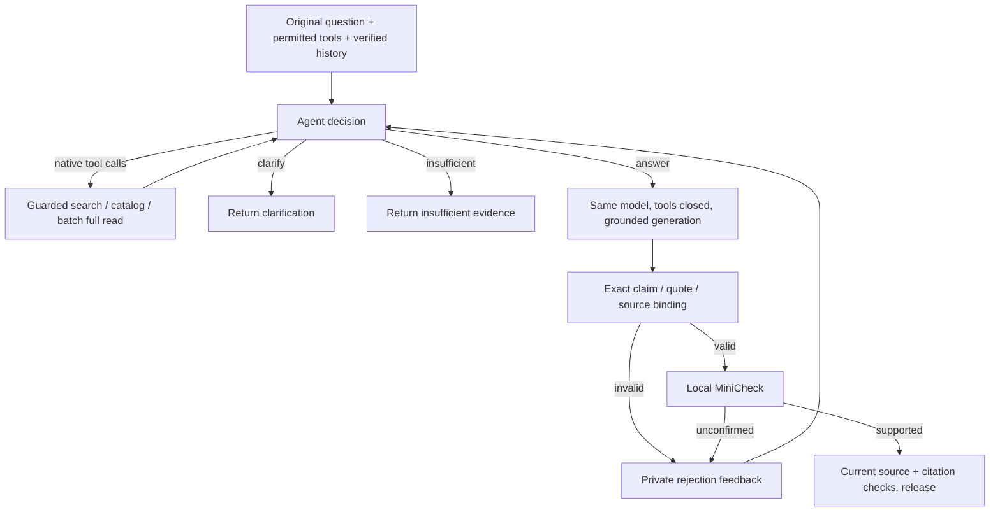

# Fast / Thinking execution contract

Current implementation: 2026-10-19. Each mode owns its flow. Shared source
selection, Memory, tools, bindings and permissions do not select a mode.
Omission defaults to Fast; `auto` is a compatibility alias for Thinking.
Neither mode implicitly creates Research or switches to the other mode.

## Fast

Identity/source checks → trusted Memory → deterministic source/file tools using
the original question → one answer request → binding/citation/source checks → release.

- No rewriting, expansion, planning, model tool selection, generation repair,
  title generation or post-turn model compaction. One HTTP attempt, no fallback.
- Enterprise retrieval uses `search_direct`; Personal Library stays owner/KB
  scoped. Trusted `retrieval_sources` selects source kinds, never grants.
  Selected files and explicitly selected sources are mandatory. An empty
  optional default library does not substitute for or block enterprise evidence.
- Files use persisted parsing/OCR and tables. Original images join the same
  final multimodal call, excluding independent `vision_analysis`. No independent
  visual model runs. Unsupported configured image models return `unsupported`.
- `ANSWER_FAST_MODEL`, `ANSWER_FAST_MODEL_THINKING`,
  `FAST_MODEL_SUPPORTS_IMAGES=false`, `FAST_CONTEXT_MAX_CHARS=12000` configure
  the fixed Fast model and input capability. Deterministic retrieval/reranking
  computation is separate from generative model calls.
- Empty required evidence ends without generation. Malformed model output,
  tool calls from the answer model, invalid bindings or citations fail without
  another generation. Source authorization/version failures remain fail-closed.
- Evidence JSON is buffered and validated before a `token` is released.
  Pure dialogue without evidence can stream provider deltas.

## Thinking



- The **first model request** contains the original question, actual permitted
  native tool schemas, verified conversation history and trusted scope. There
  is no preliminary classifier, rewrite, plan or compulsory retrieval call.
- The Prompt owns ambiguity clarification, reference resolution, search query
  rewriting/splitting and strategy selection. Old intent classifiers, semantic
  source heuristics, policy routers, completeness/repair models and rule-based
  answer extractors are absent from this flow.
- Control responses always use native functions: source tools, `prepare_answer`,
  `ask_clarification(question=...)`, or `report_insufficient(reason=...)`.
  Control actions are registered schemas, must appear alone in a turn, and do
  not perform source IO or consume tool IO allowance. They consume model budget.
  The controller uses `tool_choice=required`; no JSON control content is mixed
  with native calls. Final claims JSON is generated in a separate tool-free call.
- The Agent may inspect `find_documents` (optional query, offset pagination)
  and batch `get_document(doc_ids=[...])` after insufficient TopK, or read known
  permitted IDs directly. The read tool still returns complete parsed bodies
  and exact source chunks; catalog metadata alone is never answer evidence.
- A request-local pool retains full original results and lineage server-side.
  Model views contain complete bodies once, with reference offsets or exact
  quote scopes when parsed chunks are noncontiguous. Complete excerpts are
  used when a body does not fit. Source prose is never silently truncated.
  Catalog/actions/omission counts also consume context space.
- Every actual tool execution is counted, including duplicates. Repeated
  equivalent calls are stopped at `MAX_REPEATED_TOOL_CALLS`. Native calls in
  one response execute in order under the same allowance.
- Request filters constrain every enterprise search/catalog/read. Models can
  narrow but cannot widen explicit document selections. Personal and attachment
  tools retain trusted request-local owner/KB/file contexts. Explicitly required
  source types must have actual current evidence before answer generation.
- Wiki tools remain unavailable even if registered. No old exploration branch,
  keyword complexity route or question-specific automatic reread remains.

## Private answer protocol

Both evidence answer models generate this object in the same answer call:

```json
{"claims":[{"text":"The release is planned.","supports":[{"citation_id":1,"quote":"The release is planned."}]}]}
```

Each visible paragraph is `claim.text`. The server joins paragraphs and renders
citation markers from supports. No second answer field, self-score or confidence
threshold is allowed. Quotes bind to the exact numbered excerpt, with whitespace
normalization only; image-region supports are separate from text quotes.
An explicit empty claims list is abstention (`no_relevant_context`).

Binding records source/answer offsets, identities, versions and hashes. Its
`valid` means binding integrity; `semantic_validation=not_performed` remains
accurate for that separate report. Thinking stores MiniCheck results separately.
Private binding/verdict/feedback data never enters ChatResponse, SSE, frontend
diagnostics or saved message text.

## MiniCheck release and regeneration

- Thinking uses only local `lytang/MiniCheck-DeBERTa-v3-Large`, loaded with
  `local_files_only=True` and `trust_remote_code=False`. The optional installation
  `verified.json` manifest is required and checked before weight loading. Its
  repository identity, weight filename and SHA-256 must match; the loader pins
  the verified `pytorch_model.bin` or `model.safetensors` format even if both
  files exist. The offline runner uses the same identity check. Requests never
  download weights or invoke an external judge API.
- Only valid bound sources enter the [verification context builder](verification_context.md).
  It retains headings, table headers, relevant rows, qualifications and source
  boundaries. Input is `premise + eos_token + claim`; argmax label 1 is supported.
  No self-evaluation score or evidence-count acceptance rule remains.
- The complete encoded input must fit 512 tokens. Missing lineage, unavailable
  text/image context or overlong inputs are **unverified**, not false and not
  supported. No semantic input is truncated to force a result.
- Any unconfirmed claim sends private failure/quote feedback to the same Agent
  loop. The Agent may obtain evidence, correct or remove assertions, regenerate,
  clarify or abstain. Every replacement undergoes fresh binding and MiniCheck.
- A classifier rejection is not proof of falsity. The Prompt requires revision
  against source meaning, not simply wording chosen to please the classifier.
  MiniCheck is imperfect; it does not establish answer completeness, claim
  atomicity, source truth or freedom from false acceptances.
- Exhaustion after an invalid/rejected candidate returns
  `quality_validation_failed` with no answer or citations. Otherwise execution
  limits return `agent_limit_reached`. Missing/broken classifier infrastructure
  returns `tool_error`; there is no unchecked fallback.
- Fast retains its one-generation binding-only contract. It does not enter
  MiniCheck regeneration or Thinking's control loop.

## Shared Thinking budget

| Setting | Default | Counts / behavior |
| --- | ---: | --- |
| `THINKING_MAX_MODEL_CALLS` | 10 | Every control, answer and failed provider attempt |
| `THINKING_MAX_TOOL_CALLS` | 8 | Every actual tool execution |
| `THINKING_CONTEXT_MAX_CHARS` | 30000 | Serialized messages, tools, metadata and feedback |
| `THINKING_MAX_RESERVED_TOKENS` | 150000 | Conservative UTF-8 byte input allowance + full output allowance + framing per call; not exact provider token usage |
| `THINKING_MAX_VERIFICATIONS` | 48 | Every claim check, including unverified inputs |
| `THINKING_TIMEOUT_SECONDS` | 180 | Loop wall-clock allowance; model/tool waits bounded by remaining time |
| `MAX_REPEATED_TOOL_CALLS` | 2 | Equivalent argument executions before termination |
| `LLM_MAX_TOKENS` | 2000 | Per-call output allowance; actual environment may override |
| `MINICHECK_MODEL_PATH` | `data-persistence/models/minicheck` | Local approved model directory |
| `MINICHECK_CPU_THREADS` | 4 | Local inference threads |

All failed attempts consume allowance. Production Thinking uses one HTTP attempt
per call and no fallback models; retries must return to the counted loop. Titles
use deterministic question text, with no extra model. Budget counters and
verdicts are request-local; only immutable model weights/tokenizer are shared.
Inference and permission checks already in progress are not forcibly interrupted;
the deadline is checked before/after them and prevents subsequent work/release.

## Authorization and output

Current identity, native permissions, selected source scope and version/hash
checks run before tools, every model/classifier use, retries and final release.
Thread-pool work keeps ContextVars. No positive access result or last-request
source state is shared across requests.

JSON and SSE drive the same Thinking loop. Candidate prose, control text,
reasoning and rejection feedback are buffered privately; only final accepted
text is emitted. Reader and Memory reuse retain current-source rechecks.
Ordinary saved snapshot browsing follows the separate local ownership policy.

Tests use English controlled boundaries for the loop and the production guard.
Real classifier/model smoke and its limits are recorded separately; unit tests
are not live BFF/parser/native-source acceptance or an unseen quality benchmark.
