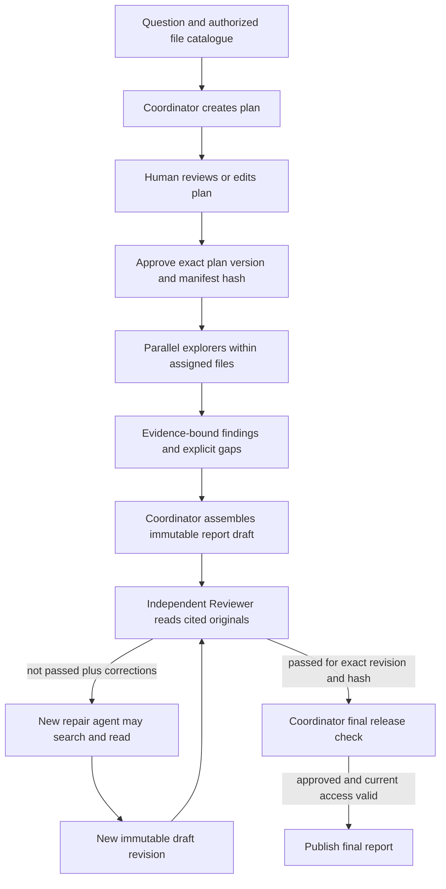

# Deep Research coordinator architecture

The production enterprise runtime creates `execution_mode=coordinator` plans.
This is the only executable Research harness. The old sequential Worker,
coverage/claim-generation pipeline, numeric/lexical semantic verifier,
deterministic fallback renderer, question-specific Research response recipes,
legacy graph, spike and executable demo Mock have been removed.
The configured Thinking model supplies the planning, explorer, coordinator,
Reviewer and repair roles. Each role invocation has explicit instructions and a
separate input context; explorers execute concurrently in bounded thread pools.
These are application agents, not separate provider models or OS processes.

## Planning and human approval

Planning receives the user's question and the complete authorized file catalogue
(number, title and version). Titles are routing metadata, never factual evidence.
The saved Plan also exposes `source_files` with server-bound IDs. It specifies
task questions, assigned files, acceptance criteria, necessary dependencies and
budgets. Independent tasks have empty dependencies. The UI permits editing the
objective, tasks, assigned files, dependencies and evidence targets. Reordering
tasks does not introduce dependencies. Saving creates a new immutable version;
execution requires explicit approval of the current `plan_version` and
`manifest_hash`. Planning failures fail closed without a mock fallback.

## Roles and evidence

| Role | Responsibility | Tools |
| --- | --- | --- |
| Main coordinator | Plan, coordinate, synthesize findings, final release check | None during execution |
| Explorer | Answer one approved task with atomic findings and explicit gaps | Search and original read in assigned files |
| Reviewer | Check all factual blocks, citation support, plan coverage and uncertainty against fresh original reads | Read sources cited by the draft |
| New repair agent | Address rejected blocks using the review package; submit a new revision | Search/read within approved manifest |

Search results are Observations, not evidence. Only an original read with matching
source version/hash creates VerifiedEvidence. A Finding binds a short statement
to evidence IDs, exact supporting quotes and task criteria. The coordinator
receives these findings and their original quotes, with task results and gaps;
it cannot invoke explorer tools. Dependency results are explicitly passed to
dependent explorers.

The Reviewer receives the exact draft's indexed blocks, plan criteria and freshly
read cited originals. A pass must enumerate every factual block and every used
citation. Structural/citation checks run as an additional gate. An LLM review
remains fallible: enumerating blocks is an audit contract, not proof of semantic
correctness. The product Reviewer is distinct from offline MiniCheck evaluation
and does not authorize an external evaluation judge.

`ReportDraft`, `ReportReview`, `CoordinatorApproval`, `AgentStep` and `AgentResult`
are persisted separately. Review records bind the immutable draft ID, revision
and report hash. A failed draft remains `not_passed` in the UI. Each repair
revision uses a new agent identity/context and must receive a fresh review;
unchanged supported paragraphs and existing citation numbers are preserved.
Only reviewer-identified existing blocks can be edited. Structural changes that
cannot be repaired this way fail closed. The main coordinator then approves
the exact reviewed content without rewriting it.

## Budgets, failure and recovery

New production plans default to three concurrent explorers, eight model decisions
per explorer/repair agent, at most two repair rounds (three draft revisions),
64 total search/read calls and 900 seconds from execution start. Each explorer
also has its approved task action cap. Reviewer reads and repair tools consume
the shared tool budget. Token accounting uses the approved `max_tokens`, normally
64,000 completion tokens including reasoning, shared across every execution role
and staged report generation. Provider input/context and TPM limits are separate.
Planning has its own preapproval completion budget.

SQLite reservations are made before model/tool calls and token charges survive
restart. Unknown transport usage stays reserved. The runtime propagates
ContextVars into explorer and nested tool pools. Dependency scheduling, results,
drafts, reviews, decisions and approvals are durable; replay reuses completed
entities, but interrupted calls may be retried and charged again. A restart does
not replenish execution time, tokens or tools. This implementation assumes one
application dispatcher per Research database; it does not provide distributed
worker leases or multi-process scheduling guarantees.

Cancellation is supported during exploration and synthesis. Current identity,
native permission (production), source version/hash, cancellation and time guards run at
model/tool boundaries and before release. A stopped task, invalid role output,
exhausted budget, unrepaired review failure or rejected main check cannot release
a final report. An approved report with explicit evidence gaps may still declare
`result_status=degraded`; that is separate from `review_status=passed`.

Only the final approved artifact enters the public `report` entity. Report reads
also require the Job to be completed. Saving a coordinator report requires its
exact content to match the passed review and final approval; an old conflict
choice command cannot rewrite it. Request a new approved research job to revise
an already released report.

## API, persistence and compatibility

Existing routes and session/CSRF/native access boundaries remain. Snapshot adds
`team` (or null for legacy): agent outcomes/running explorers, draft metadata and
derived review status, reviews with corrections, and `completion_tokens_used`.
It does not expose draft bodies as final reports. The protected evaluation trace
adds `agents`, `agent_steps`, `drafts` and `reviews` for diagnosis.

New stages are `parallel_exploration`, `coordinator_synthesis`, `review_report`,
`repair_report`, `coordinator_check`, `publish_report`, then `completed`.
Review and repair append `report_reviewed` / `report_revised` events.
Final reports add `revision`, `review_id`, `review_status` and
`coordinator_approved`. Old saved plans without a mode still parse as `legacy`
for historical browsing only. They cannot be approved or resumed by the removed
runtime; start a new job and review its new harness Plan. No automatic conversion
reinterprets an old approval. Old persisted reports/evidence are retained, not
deleted or relabeled as reviewed. Progress adds `finding_count`; legacy
`claim_count` and trace claim/verification readers remain for saved data, but new
execution does not duplicate Findings into Claims or produce rule verdicts.

The browser always calls the real same-origin BFF. `VITE_RESEARCH_USE_MOCK` and
the executable frontend mock workflow are removed. Tests inject fixtures through
explicit server-side constructors; application planning has no Mock fallback.

Research SQLite creates the additive `research_model_usage` table automatically;
role records use the existing `research_entities` store. No Web migration or
source/index rebuild is needed. Back up Research DB and checkpoint files together
before rollout. Keep runtime databases and credentials outside the checkout.

## Local development file access

Set `RESEARCH_DEVELOPMENT_MODE=true` and `HOST=127.0.0.1` in the ignored Agent
environment for local development. This grants the complete Research catalog to
every enabled signed-in user without requiring per-file local/native grants,
including files not registered in the local ACL tables. The flag cannot be
selected in browser payloads and is refused with a non-loopback Agent host.
Production leaves it false and retains local/native intersection checks.

Development still verifies active identity, job ownership, BFF session/CSRF,
manifest/task scope and current source version/hash at every usage boundary.
It cannot read arbitrary filesystem paths or files outside the Research catalog.
It does not enable personal-library/attachment Research or relax ordinary Chat.
Run native-permission acceptance with the flag explicitly false; a development
run cannot establish production ACL acceptance.

## Validation boundaries

`tests/integration/test_research_team.py` injects a deterministic model while
using real local tools, SQLite and LangGraph. It verifies actual overlapping
explorer execution, approval version binding, review/repair/review release,
rejections, evidence identity, review block coverage, ContextVar propagation,
durable token reservations, cancellation and interrupted recovery. Frontend tests
cover editable independent tasks and failed/passed revision display.

These tests establish orchestration behavior, not real Groq quality, native
Confluence/Milvus acceptance or repeat stability. The earlier 2026-10-19 real
model traces precede this architecture and must not be relabeled as its acceptance.
Run the isolated real-model workflow from the shared runbook before making those
claims; retain every draft, review, failure and retry for per-case human review.

Before removal of the old pipeline, 2026-10-19 local validation: Agent `python -m pytest` passed 1,069 tests
(including 14 team integration cases); frontend `pnpm test` passed 318 tests in
61 files, `vue-tsc --noEmit` passed, and `pnpm build` passed using a fresh external
SQLite database and `AI_QA_BUILD_DIR`. Agent JUnit evidence is at
`D:/AI-QA-Assistant/research-team-delivery-tests-20261019.xml`; build output is
`D:/AI-QA-Assistant/research-team-delivery-build-20261019`. The suite uses injected
models/transports and does not change the real-acceptance boundary above.

After legacy removal and the local development policy change, the Research-only
suite passed 117 tests (including 18 harness orchestration cases and eight
development-access cases). Evidence:
`D:/AI-QA-Assistant/research-harness-clean-delivery-20261019.xml`.
Frontend passed 318 tests and type checking; the isolated production build passed
at `D:/AI-QA-Assistant/research-harness-delivery-build-20261019`.
The full Agent suite was attempted, but ordinary Chat was being independently
refactored in the same workspace and collection failed on its retired interfaces.
That work was preserved; this Research result does not claim a combined full-suite
pass. Tests of removed workers, heuristic verifiers, fallback renderers and the
obsolete executable demo were retired with that code; current harness, permission,
budget, review and read-boundary coverage remains.

Once the parallel Chat work completed, the combined 2026-10-19 suite passed
639 Agent tests. The consolidation review additionally verifies transitive
dependency failure blocking, complete Markdown input to Reviewer, and completed
repair status during second review. See the
[optimization review](../../docs/testing/integration/optimization-consolidation-20261019.md)
for the final combined checks and unchanged live-acceptance limits.
